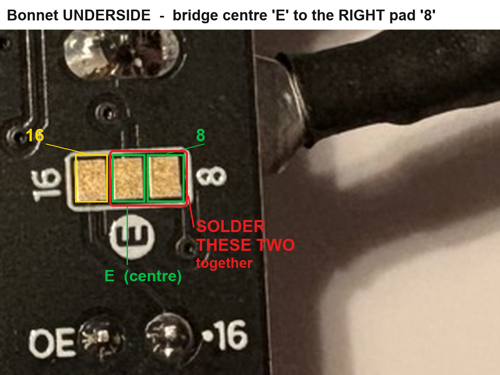
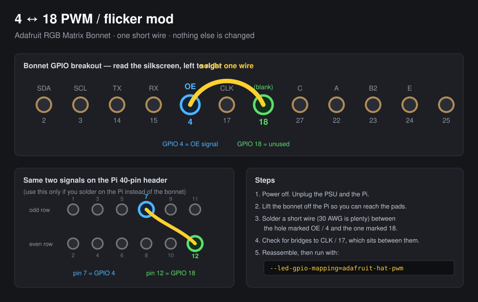
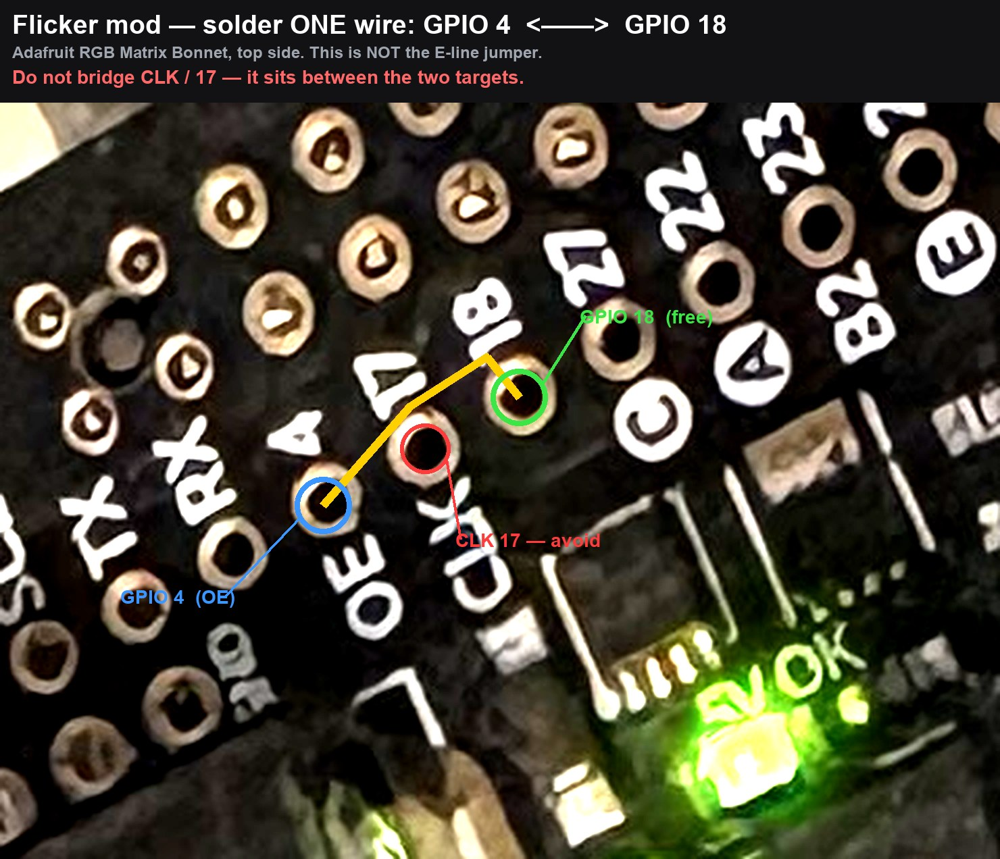

# LED Board — Project Plan

A Raspberry Pi–driven RGB LED matrix display with a browser-based designer for
composing text, emoji, images and animations.

---

## 1. Hardware

### Panels — 3 × 64×64 RGB matrix
Identified from board silkscreen:

| Property | Value |
|---|---|
| Model | `DCHY-P2-6464-1515-VP` (sticker: `P2-8L-200`) |
| Resolution | **64 × 64** per panel |
| Pitch | **P2** (2 mm) → each panel ≈ **128 × 128 mm** |
| Connector | **HUB-75E** (the `E` 5th address line is required for 64-row panels) |
| Driver ICs | CHIPONE `ICN2037BP` / `ICN2038S` |
| Scan rate | 1/32 |

### Controller — Adafruit RGB Matrix Bonnet for Raspberry Pi
- HUB75 output, 5 V screw terminal for external power, `5V OK` indicator LED
- GPIO breakout labelled `OE / CLK / LAT`, `R1 G1 B1 / R2 G2 B2`, address lines `A B C D E`
- Compatible with `hzeller/rpi-rgb-led-matrix` via `--led-gpio-mapping=adafruit-hat`
  (or `adafruit-hat-pwm` after the PWM mod, for less flicker)

### Power
- Each 64×64 P2 panel draws up to **~4 A @ 5 V** at full white (~20 W)
- 3 panels → **~12 A / 60 W peak**
- Requires a dedicated **5 V 10–15 A** supply into the bonnet's screw terminal
- ⚠️ Do **not** power the panels from the Pi's own supply
- Realistic text/emoji content draws far less, but size the PSU for peak

---

## 2. Layout / canvas shapes

**Initial target: `64 × 192`** (64 wide × 192 tall — vertical/portrait stack of 3 panels).

The design must not hard-code this. Planned supported arrangements:

| Shape | Description |
|---|---|
| **64 × 192** | Portrait — 3 panels stacked vertically *(first target)* |
| 192 × 64 | Landscape — 3 panels in a row |
| L-shape | Non-rectangular arrangement |

**Implication:** the renderer needs a **panel-mapping layer** that translates a
logical canvas (any shape) into the physical chain order + per-panel rotation.
`rpi-rgb-led-matrix` supports this via `--led-chain`, `--led-parallel` and its
pixel-mapper (`U-mapper`, `Rotate:90`, etc.); custom shapes (L) may need a
custom mapper or a software-side coordinate remap.

---

## 3. Software stack

- **Driver:** [`hzeller/rpi-rgb-led-matrix`](https://github.com/hzeller/rpi-rgb-led-matrix)
  — de-facto standard for HUB75 on Pi, has Python bindings
- Example invocation (landscape chain of 3):
  ```
  --led-rows=64 --led-cols=64 --led-chain=3 \
  --led-gpio-mapping=adafruit-hat
  ```

---

## 4. ⚠️ Assembly — what must be soldered

Three solder jobs. Do them in one session; only the first two are mandatory.

### 4.1 Solder the 2×20 header onto the Pi Zero W  *(required)*

The Zero W ships with **bare through-holes** — no pins. Nothing can be plugged
in until a 2×20 male header is soldered on. (A "Zero **WH**" would already have
one; ours does not.)


- Insert the header from the **top/component side** so the **long pins point UP**
- Solder on the **underside** (the side without the black plastic spacer)
- **Tack two opposite corners first**, confirm the header sits flat and square,
  *then* solder the remaining 38 — straightening it afterwards is painful
- Check for solder bridges between neighbouring pins when done

No iron / not confident? A **GPIO Hammer Header** (press-fit, solderless, ~$6)
does the same job, or any maker space will do a 40-pin header in minutes.

### 4.2 Bridge the E-line jumper  *(required for 64×64)*

64×64 panels use 1:32 multiplexing and need a 5th address line (`E`). Our bonnet
is the newer type with **Address-E pads** on the underside, so this is a solder
blob rather than a wire.


The three pads sit **side by side** (not stacked) on the bonnet's underside,
just above the `OE` test-point block. They are the only group of three bare gold
rectangles on the board. On our actual bonnet:



`16` = left pad · `E` = centre pad (circled **E** label below it) · `8` = right pad.

Per the [library README](https://github.com/hzeller/rpi-rgb-led-matrix#64x64-with-e-line-on-adafruit-hatbonnet):

> Melt a blob of solder between the center "E" pad and the "8" pad just above it
> (for 64x64 matrices in the Adafruit shop)… *or* the "16" pad below (rare, for
> some third-party 64x64 matrices… check datasheet).

- **Start with `E → 8`.**
- ⚠️ Our panels are **third-party** (`DCHY-P2-6464-1515-VP`), so `E → 16` is a
  genuine possibility. If the panel lights only half, or shows duplicated
  halves, wick the solder off and bridge `E → 16` instead.

**Without this jumper only half of each 64×64 panel lights up** — the single most
common failure for 64×64 + Adafruit HAT.

### 4.3 Flicker mod: bridge GPIO 4 &harr; GPIO 18  *(strongly recommended here)*





> ⚠️ **Not to be confused with the `E → 8` jumper (§4.2).** That one is solder
> *pads on the bonnet's underside* and is already done. This one is a *wire
> between breakout holes on the top*. The "8" in `E → 8` is a pad name, not a
> GPIO. **GPIO 8 is not involved in this mod at all.**

**Why it works.** The bonnet drives the panels' **OE** (output-enable) line from
**GPIO 4**. OE is what gates each row on and off, so any jitter in its timing
shows up directly as visible flicker. GPIO 4 has no hardware-PWM capability, so
the library has to toggle it in software, at the mercy of scheduling on a
single-core ARMv6. **GPIO 18 is one of the Pi's hardware PWM pins** and is left
**unused** by the bonnet. Wiring them together lets the library hand OE timing to
the PWM peripheral, which is jitter-free regardless of CPU load.

**Confirmed on our board:** the breakout row reads
`SDA 2 | SCL 3 | TX 14 | RX 15 | OE 4 | CLK 17 | (blank) 18 | C 27 | A 22 | B2 23 | E 24 | 25`.
GPIO 18 carries **no function label**, confirming it is free &mdash; that is what
makes the bridge safe.

**Do it:**
1. Power off &mdash; unplug both the panel PSU and the Pi.
2. Lift the bonnet off the Pi so the pads are reachable.
3. Solder one short wire (30 AWG is plenty) between the hole marked **`OE` / `4`**
   and the hole marked **`18`**. Identify them by the **silkscreen text**, not by
   position in a photo.
4. Inspect for a bridge to **`CLK` / `17`**, the hole physically between the two
   (the three run in a straight line: `OE 4` &rarr; `CLK 17` &rarr; `18`).
   Shorting CLK to OE will stop the display working entirely.
5. Reassemble and run with `--led-gpio-mapping=adafruit-hat-pwm`.

> The wire alone does nothing. The GPIO mapping **must** change from
> `adafruit-hat` to `adafruit-hat-pwm`, or the library keeps bit-banging GPIO 4
> and ignores the new path.

**What to expect.** This does **not** raise the refresh rate much &mdash; we measured
~44 Hz at full 11-bit depth and that is a CPU ceiling. What it removes is the
*jitter*, which is what makes a low refresh rate read as flicker. If it is still
not good enough afterwards, the honest fix is a **Zero 2 W (~$15)**: same form
factor and GPIO, quad-core.

**Alternative location:** the same two signals appear on the Pi's 40-pin header as
**physical pin 7 (GPIO 4)** and **physical pin 12 (GPIO 18)** &mdash; only relevant if
you would rather solder on the Pi than the bonnet.

### 4.4 Software-side prerequisites

1. **Pi 5 is NOT supported** (RP1 GPIO) → `www` is ruled out
2. **Disable onboard audio**: `dtparam=audio=off` in `/boot/firmware/config.txt`
   — onboard sound shares the PWM hardware and causes flicker
3. **Dedicate the machine** — the driver bit-bangs GPIO and is timing-sensitive

## 5. Host selection

| Host | Model | Verdict |
|---|---|---|
| `www` (192.168.1.112) | **Pi 5** | ❌ library unsupported |
| `pi` (192.168.1.134) | Pi 4B Rev 1.4 | ❌ runs Homebridge / garage door — don't add timing-critical GPIO work |
| `pi2` (192.168.1.113) | Pi 4B Rev 1.2 | ❌ CI host — build bursts would cause flicker |
| **Pi Zero W** (`zero`, 192.168.1.209) | **BCM2835, ARMv6 single-core** | ⚠️ **confirmed** — usable, but at the edge for 3 panels |

### Pi Zero W feasibility (confirmed)
The library bit-bangs GPIO, so refresh rate scales with CPU. 3 chained
64×64 panels = **12,288 pixels**.

| Model | Verdict for 3 panels |
|---|---|
| Pi Zero / Zero W (BCM2835, **single-core ARMv6**) | ⚠️ Marginal — expect flicker / low refresh. Measured ~44-50 Hz with 3 panels (see below) - usable but flickery |
| **Pi Zero 2 W** (BCM2710, **quad-core A53**) | ✅ Workable (~Pi 3 class) with tuning |

**Confirmed 2026-10-22** — `Raspberry Pi Zero W Rev 1.1`, `BCM2835`,
`ARMv6-compatible processor rev 7 (v6l)`, kernel `6.6.74+rpt-rpi-v6` (32-bit).
So we are in the *constrained* case.

⚠️ **Correction to an earlier note:** driving the panels as *three independent
displays* is **not possible with this bonnet**. The Adafruit Bonnet wires only
one set of RGB/clock pins, so it supports a **single chain**
(`--led-parallel=1`); parallel chains need the plain GPIO mapping with more pins
broken out. The README confirms it "only allows for a single chain". The CPU has
to carry all three panels — there is no escape hatch for a slow core.

### ✅ Chain fully working — 2026-10-24

All three panels lit R/G/B via `examples-api-use/panel-id.cc` (segment 0 = RED,
1 = GREEN, 2 = BLUE). **Chain order matches the library's expectation**: segment 0
is the panel wired to the bonnet, and order runs left-to-right with no remap.

**Root cause of the two dark panels: missing 5 V.** Each 64x64 panel has its own
`+5V`/`GND` header; they are **not** powered through the HUB75 ribbon. Only the
first panel's header was connected. Data was reaching panels 2 and 3 the whole
time. The E jumper, chain wiring (OUT -> IN) and software were never at fault.

> ⚠️ Give each panel its **own** pair of leads from the PSU. Do not feed three
> panels through the bonnet's screw terminal — ~12 A at full white is far beyond
> what that terminal and the bonnet traces are rated for. The terminal powers the
> Pi/bonnet only.

#### Canvas orientation

| Config | Flags | Canvas |
|---|---|---|
| **Landscape (native)** | `--led-chain=3` | **192 x 64** |
| Portrait | `--led-chain=3 --led-pixel-mapper='Rotate:90'` | 64 x 192 |

Both verified on hardware. The mapper cannot move panels: `Rotate:90` is correct
**only once the panels are physically stacked vertically**. With them in a row,
192 x 64 is the native arrangement. **Orientation is a mounting decision.**

#### Not bugs

- **`demo -D 0`'s square looks clipped at 45 deg** — it centres a 64x64 rotating
  square on a 64-tall canvas, so the corners sweep outside and clip. Expected.
- **Horizontal banding in photographs** — camera rolling shutter vs 1/32
  multiplexing (only 2 of 64 rows lit at any instant). Looks solid to the eye.

### Measured on hardware — 2026-10-24 ✅

Driver built, panels driving. (Panel 2 photographed lit; whether all three
light is **still to be confirmed by eye** — `demo -D 0` only draws a centred
64×64 square, so panels 1 and 3 being dark in that test was expected, not a
fault.) Measured on the real rig
(`demo -D 4`, full 192×64 canvas, `--led-slowdown-gpio=0`, brightness 60):

| `--led-pwm-bits` | Refresh |
|---|---|
| 7 | **50.1 Hz** |
| 9 | 46.6 Hz |
| **11 (full depth)** | **44.1 Hz** |

**Full 11-bit colour costs only ~12% refresh.** The Zero W is bottlenecked by
GPIO bit-banging, *not* PWM depth — so the planned "drop to `--led-pwm-bits=7`
for text/emoji" trade-off is **not needed**. Run full depth; photos and
gradients stay on the table.

The real constraint is the absolute rate: **~45 Hz is visibly flickery**, and
it is stable (no dropouts over 30 s), so it is a hard CPU ceiling rather than a
transient.

**Mitigations for the Zero W:**
- `--led-slowdown-gpio=0` — the README explicitly recommends `0` for
  "Model A, A+, B+, **Zero**"
- Do the **4↔18 flicker mod** (§4.3) and switch to
  `--led-gpio-mapping=adafruit-hat-pwm`. It will not raise the refresh rate
  much, but it moves OE timing onto hardware PWM, removing the *jitter* that
  makes a low refresh rate look worse than it is. **This is now the single
  highest-value remaining change.**
- If flicker is still unacceptable after the mod, a **Zero 2 W (~$15)** is a
  drop-in replacement (same form factor and GPIO, quad-core A53).

**Recommended approach: test, don't guess.** Wire up **one** panel first and
judge the flicker by eye, then add the 2nd and 3rd. If it is not acceptable, a
**Zero 2 W (~$15)** is a drop-in replacement — same form factor and GPIO,
quad-core A53 — and still far better than tying up `pi` (garage door) or `pi2` (CI).

---

## 6. The app

A **web-based designer with a pixel-accurate preview**, usable with **no hardware attached**.

### Designer / simulator (build first)
- Canvas rendered as individual **LED dots** with accurate color + brightness
- Arbitrary canvas shape (64×192, 192×64, L-shape)
- Tools:
  - **Text** — bitmap fonts that render crisply at small pixel sizes
  - **Emoji**
  - **Image import** — auto-downscale + dithering for low-res output
  - Color picker, per-zone layout
- **Animations:** static, scrolling text, blink, transitions — previewed live
- Save / load designs

### Pi runtime (build second)
- Renders designs to a framebuffer and drives the matrix via `rpi-rgb-led-matrix`
- "Send to Pi" from the designer
- Panel-mapping layer for the chosen physical arrangement

### Why simulator first
It's hardware-independent — design and iterate in the browser while the
soldering, power supply and host selection are still being sorted.

---

## 7. Open items

### Assembly (Rax)
- [x] Solder 2×20 male header to the Pi Zero W — §4.1
- [x] Bridge E-line jumper `E → 8` — §4.2 (no half-panel/duplicated-half symptom, so `E → 8` is correct for our third-party panels — `E → 16` not needed)
- [ ] **Flicker mod: wire GPIO 4 ↔ 18 — §4.3 — now the top priority** (then `--led-gpio-mapping=adafruit-hat-pwm`)
- [x] Each panel fed its own 5 V leads — this was the cause of the dark panels
- [ ] Confirm the PSU is rated **5 V 10–15 A** for all three at full white

### Bring-up
- [x] Deploy SSH key to `zero` (192.168.1.209) so the build can be driven remotely
- [x] Build `rpi-rgb-led-matrix` on the Zero. (`text-example` first appeared to fail; it was **killed by a reboot mid-build**, not OOM — no `oom-kill` in `dmesg` and the 512 MB swap was untouched. Rebuilt cleanly. A full build takes several minutes on ARMv6 — run it detached.)
- [x] `dtparam=audio=off` in `/boot/firmware/config.txt` + `snd_bcm2835` blacklisted (verified unloaded after reboot)
- [x] All 3 panels verified lit and in correct chain order (`panel-id` R/G/B test)
- [ ] Judge flicker **after** the 4↔18 mod → Zero W good enough, or move to a Zero 2 W
- [x] Chain order confirmed correct as wired (segment 0 = panel at the bonnet)
- [ ] **Decide mounting: row (192×64, native) vs vertical stack (64×192, needs `Rotate:90`)**

### App
- [ ] Build browser designer/simulator (hardware-independent — not blocked by any of the above)
- [ ] Build Pi runtime + "send to Pi" pipeline
- [ ] Panel-mapping layer (64×192 / 192×64 / L-shape)
