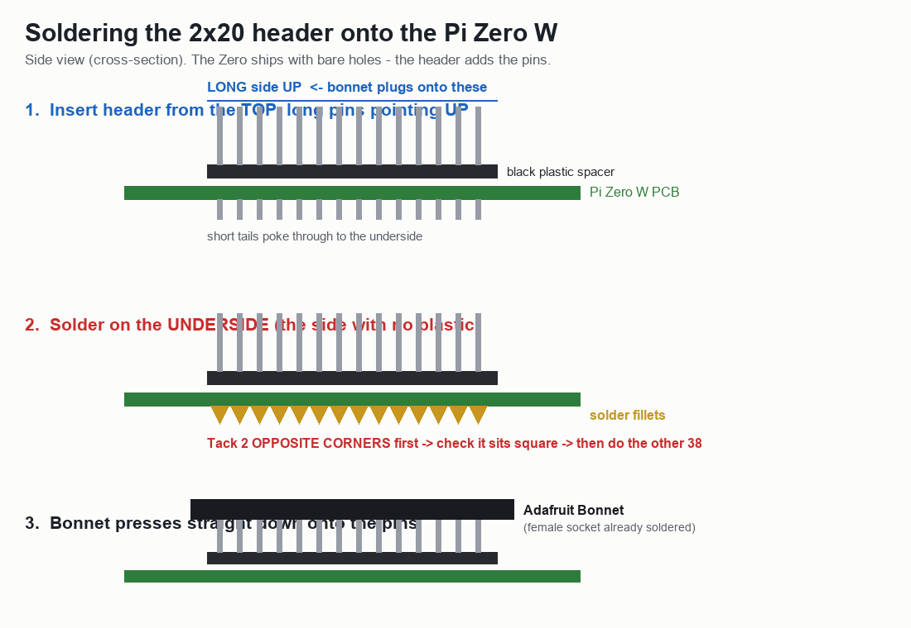
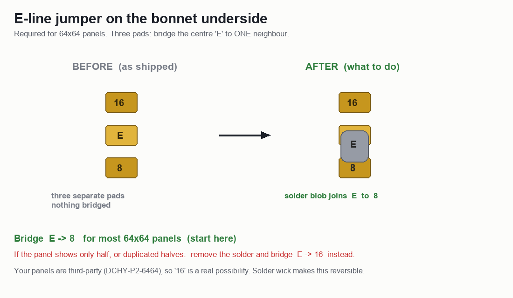

# LED Board — Project Plan

A Raspberry Pi–driven RGB LED matrix display with a browser-based designer for
composing text, emoji, images and animations.

---

## 1. Hardware

### Panels — 3 × 64×64 RGB matrix
Identified from board silkscreen:

| Property | Value |
|---|---|
| Model | `DCHY-P2-6464-1515-VP` (sticker: `P2-8L-200`) |
| Resolution | **64 × 64** per panel |
| Pitch | **P2** (2 mm) → each panel ≈ **128 × 128 mm** |
| Connector | **HUB-75E** (the `E` 5th address line is required for 64-row panels) |
| Driver ICs | CHIPONE `ICN2037BP` / `ICN2038S` |
| Scan rate | 1/32 |

### Controller — Adafruit RGB Matrix Bonnet for Raspberry Pi
- HUB75 output, 5 V screw terminal for external power, `5V OK` indicator LED
- GPIO breakout labelled `OE / CLK / LAT`, `R1 G1 B1 / R2 G2 B2`, address lines `A B C D E`
- Compatible with `hzeller/rpi-rgb-led-matrix` via `--led-gpio-mapping=adafruit-hat`
  (or `adafruit-hat-pwm` after the PWM mod, for less flicker)

### Power
- Each 64×64 P2 panel draws up to **~4 A @ 5 V** at full white (~20 W)
- 3 panels → **~12 A / 60 W peak**
- Requires a dedicated **5 V 10–15 A** supply into the bonnet's screw terminal
- ⚠️ Do **not** power the panels from the Pi's own supply
- Realistic text/emoji content draws far less, but size the PSU for peak

---

## 2. Layout / canvas shapes

**Initial target: `64 × 192`** (64 wide × 192 tall — vertical/portrait stack of 3 panels).

The design must not hard-code this. Planned supported arrangements:

| Shape | Description |
|---|---|
| **64 × 192** | Portrait — 3 panels stacked vertically *(first target)* |
| 192 × 64 | Landscape — 3 panels in a row |
| L-shape | Non-rectangular arrangement |

**Implication:** the renderer needs a **panel-mapping layer** that translates a
logical canvas (any shape) into the physical chain order + per-panel rotation.
`rpi-rgb-led-matrix` supports this via `--led-chain`, `--led-parallel` and its
pixel-mapper (`U-mapper`, `Rotate:90`, etc.); custom shapes (L) may need a
custom mapper or a software-side coordinate remap.

---

## 3. Software stack

- **Driver:** [`hzeller/rpi-rgb-led-matrix`](https://github.com/hzeller/rpi-rgb-led-matrix)
  — de-facto standard for HUB75 on Pi, has Python bindings
- Example invocation (landscape chain of 3):
  ```
  --led-rows=64 --led-cols=64 --led-chain=3 \
  --led-gpio-mapping=adafruit-hat
  ```

---

## 4. ⚠️ Assembly — what must be soldered

Three solder jobs. Do them in one session; only the first two are mandatory.

### 4.1 Solder the 2×20 header onto the Pi Zero W  *(required)*

The Zero W ships with **bare through-holes** — no pins. Nothing can be plugged
in until a 2×20 male header is soldered on. (A "Zero **WH**" would already have
one; ours does not.)



- Insert the header from the **top/component side** so the **long pins point UP**
- Solder on the **underside** (the side without the black plastic spacer)
- **Tack two opposite corners first**, confirm the header sits flat and square,
  *then* solder the remaining 38 — straightening it afterwards is painful
- Check for solder bridges between neighbouring pins when done

No iron / not confident? A **GPIO Hammer Header** (press-fit, solderless, ~$6)
does the same job, or any maker space will do a 40-pin header in minutes.

### 4.2 Bridge the E-line jumper  *(required for 64×64)*

64×64 panels use 1:32 multiplexing and need a 5th address line (`E`). Our bonnet
is the newer type with **Address-E pads** on the underside, so this is a solder
blob rather than a wire.



Per the [library README](https://github.com/hzeller/rpi-rgb-led-matrix#64x64-with-e-line-on-adafruit-hatbonnet):

> Melt a blob of solder between the center "E" pad and the "8" pad just above it
> (for 64x64 matrices in the Adafruit shop)… *or* the "16" pad below (rare, for
> some third-party 64x64 matrices… check datasheet).

- **Start with `E → 8`.**
- ⚠️ Our panels are **third-party** (`DCHY-P2-6464-1515-VP`), so `E → 16` is a
  genuine possibility. If the panel lights only half, or shows duplicated
  halves, wick the solder off and bridge `E → 16` instead.

**Without this jumper only half of each 64×64 panel lights up** — the single most
common failure for 64×64 + Adafruit HAT.

### 4.3 Flicker mod: wire GPIO 4 ↔ GPIO 18  *(strongly recommended here)*

Solder a short wire between GPIO 4 and GPIO 18, then run with
`--led-gpio-mapping=adafruit-hat-pwm`. This enables hardware PWM and noticeably
reduces flicker.

**Worth doing on a Zero W specifically** — flicker is exactly the weak point of a
single-core ARMv6 driving 12,288 pixels, so this buys back real headroom.

### 4.4 Software-side prerequisites

1. **Pi 5 is NOT supported** (RP1 GPIO) → `www` is ruled out
2. **Disable onboard audio**: `dtparam=audio=off` in `/boot/firmware/config.txt`
   — onboard sound shares the PWM hardware and causes flicker
3. **Dedicate the machine** — the driver bit-bangs GPIO and is timing-sensitive

## 5. Host selection

| Host | Model | Verdict |
|---|---|---|
| `www` (192.168.1.112) | **Pi 5** | ❌ library unsupported |
| `pi` (192.168.1.134) | Pi 4B Rev 1.4 | ❌ runs Homebridge / garage door — don't add timing-critical GPIO work |
| `pi2` (192.168.1.113) | Pi 4B Rev 1.2 | ❌ CI host — build bursts would cause flicker |
| **Pi Zero W** (`zero`, 192.168.1.209) | **BCM2835, ARMv6 single-core** | ⚠️ **confirmed** — usable, but at the edge for 3 panels |

### Pi Zero W feasibility (confirmed)
The library bit-bangs GPIO, so refresh rate scales with CPU. 3 chained
64×64 panels = **12,288 pixels**.

| Model | Verdict for 3 panels |
|---|---|
| Pi Zero / Zero W (BCM2835, **single-core ARMv6**) | ⚠️ Marginal — expect flicker / low refresh. Mitigate with `--led-pwm-bits=7`, `--led-slowdown-gpio=0..1` (costs color depth) |
| **Pi Zero 2 W** (BCM2710, **quad-core A53**) | ✅ Workable (~Pi 3 class) with tuning |

**Confirmed 2026-10-22** — `Raspberry Pi Zero W Rev 1.1`, `BCM2835`,
`ARMv6-compatible processor rev 7 (v6l)`, kernel `6.6.74+rpt-rpi-v6` (32-bit).
So we are in the *constrained* case.

⚠️ **Correction to an earlier note:** driving the panels as *three independent
displays* is **not possible with this bonnet**. The Adafruit Bonnet wires only
one set of RGB/clock pins, so it supports a **single chain**
(`--led-parallel=1`); parallel chains need the plain GPIO mapping with more pins
broken out. The README confirms it "only allows for a single chain". The CPU has
to carry all three panels — there is no escape hatch for a slow core.

**Mitigations for the Zero W:**
- `--led-pwm-bits=7` (down from 11) — trades colour depth for refresh rate.
  Fine for solid-colour **text and emoji**; poor for photos/gradients.
- `--led-slowdown-gpio=0` — the README explicitly recommends `0` for
  "Model A, A+, B+, **Zero**"
- Do the **4↔18 flicker mod** (§4.3)

**Recommended approach: test, don't guess.** Wire up **one** panel first and
judge the flicker by eye, then add the 2nd and 3rd. If it is not acceptable, a
**Zero 2 W (~$15)** is a drop-in replacement — same form factor and GPIO,
quad-core A53 — and still far better than tying up `pi` (garage door) or `pi2` (CI).

---

## 6. The app

A **web-based designer with a pixel-accurate preview**, usable with **no hardware attached**.

### Designer / simulator (build first)
- Canvas rendered as individual **LED dots** with accurate color + brightness
- Arbitrary canvas shape (64×192, 192×64, L-shape)
- Tools:
  - **Text** — bitmap fonts that render crisply at small pixel sizes
  - **Emoji**
  - **Image import** — auto-downscale + dithering for low-res output
  - Color picker, per-zone layout
- **Animations:** static, scrolling text, blink, transitions — previewed live
- Save / load designs

### Pi runtime (build second)
- Renders designs to a framebuffer and drives the matrix via `rpi-rgb-led-matrix`
- "Send to Pi" from the designer
- Panel-mapping layer for the chosen physical arrangement

### Why simulator first
It's hardware-independent — design and iterate in the browser while the
soldering, power supply and host selection are still being sorted.

---

## 7. Open items

### Assembly (Rax)
- [ ] Solder 2×20 male header to the Pi Zero W — §4.1
- [ ] Bridge E-line jumper `E → 8` — §4.2
- [ ] Flicker mod: wire GPIO 4 ↔ 18 — §4.3
- [ ] Source **5 V 10–15 A** PSU for the panels (never power them from the Pi)

### Bring-up
- [ ] Deploy SSH key to `zero` (192.168.1.209) so the build can be driven remotely
- [ ] Build `rpi-rgb-led-matrix` on the Zero (slow on ARMv6 — can start before soldering is done)
- [ ] `dtparam=audio=off` in `/boot/firmware/config.txt`
- [ ] **Test with ONE panel first**, then add 2nd and 3rd:
      `--led-rows=64 --led-cols=64 --led-chain=1 --led-gpio-mapping=adafruit-hat-pwm --led-slowdown-gpio=0`
- [ ] Judge flicker → decide whether the Zero W is good enough or a Zero 2 W is needed
- [ ] Decide chain wiring order for the 64×192 portrait arrangement

### App
- [ ] Build browser designer/simulator (hardware-independent — not blocked by any of the above)
- [ ] Build Pi runtime + "send to Pi" pipeline
- [ ] Panel-mapping layer (64×192 / 192×64 / L-shape)
